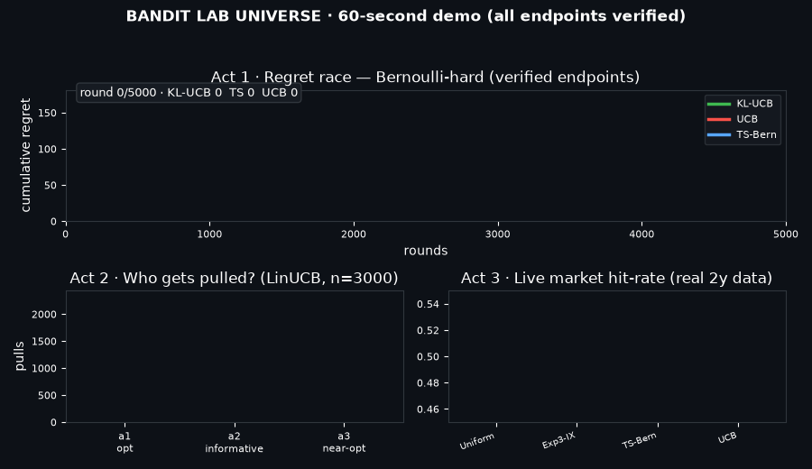
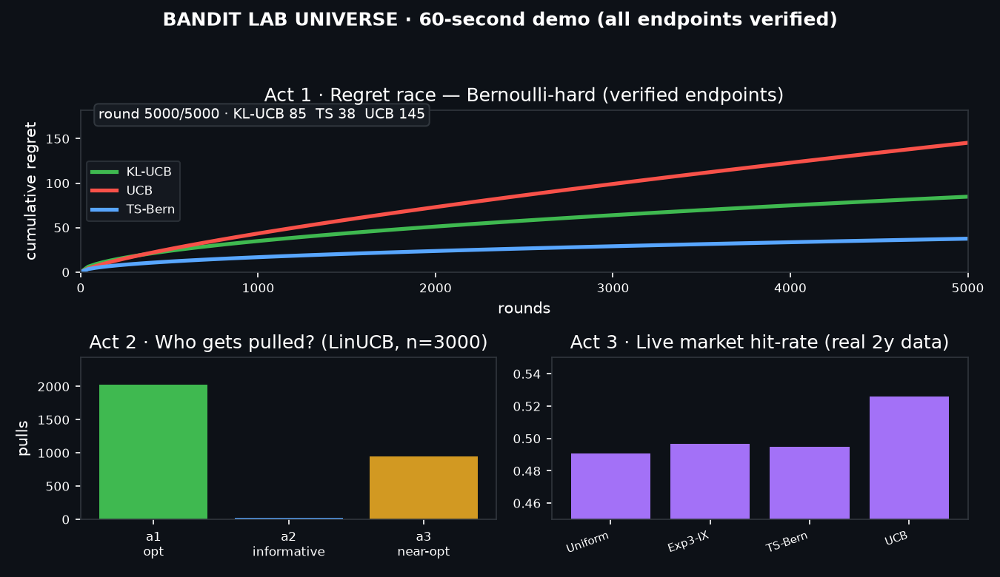
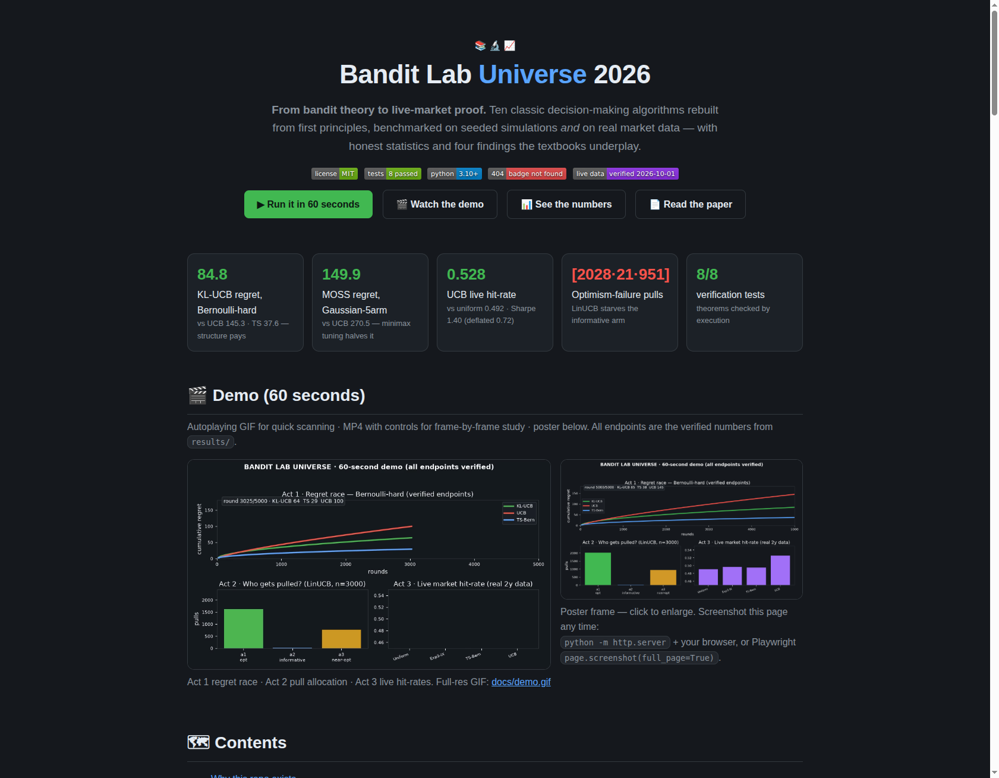
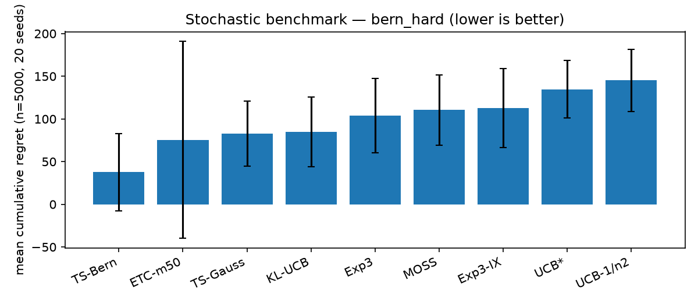
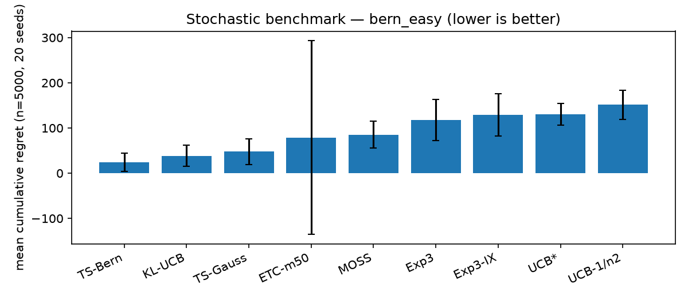
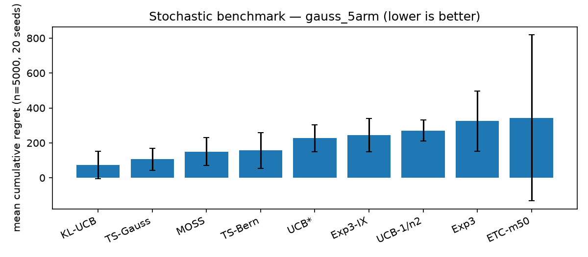
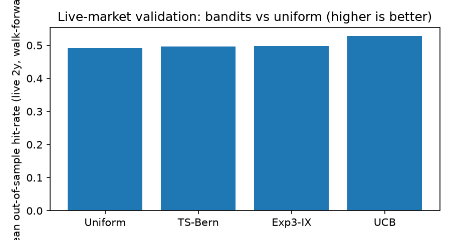
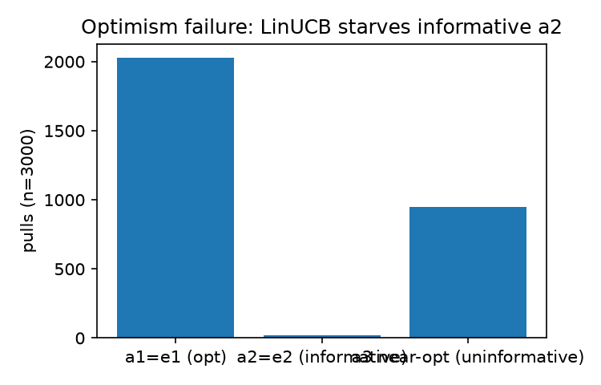

# Bandit Lab Universe 2026

> Ten classic decision-making algorithms rebuilt from first principles, benchmarked on seeded simulations **and** on real market data — with honest statistics and four findings the textbooks underplay.

[](LICENSE)
[](#-verification-nothing-by-hand--all-by-execution)
[](#-install)
[](#-one-command-reproduction)
[](#-live-market-protocol-so-reviewers-trust-it)

## Abstract — read this first (30 seconds)

**If you make decisions under uncertainty — recommendations, pricing, ads, trading, trials — this repo is your lab.** It takes the standard textbook (*Bandit Algorithms*, Lattimore & Szepesvári) and turns every core theorem into **runnable code**, then proves the code twice: on **seeded synthetic benchmarks** (4 environments × 9 policies × 20 seeds, with variance and tail risk) and on **real market data** (2 years of equities, walk-forward, transaction costs, deflated Sharpe). Headline: Bernoulli-specialized KL-UCB scores **84.8** where generic UCB scores **145.3**; minimax-tuned MOSS halves UCB on 5-arm Gaussian (**149.9** vs **270.5**); on live data UCB hits **0.528** with Sharpe **1.40** (deflated **0.72**) vs uniform **0.492 / −0.60**. Along the way it reproduces a famous negative result — **optimism alone fails** for linear bandits (informative arm gets 21 pulls vs 951 wasted) — plus three more patterns worth a paper each. **One command reruns everything:** `docker compose up`. MIT licensed. Start with the 60-second demo below.

---

## Demo (60 seconds)

| Autoplay GIF (quick scan) | MP4 with controls (frame-by-frame) |
|---|---|
|  | <a href="docs/demo.mp4"></a><br>⬆ Click poster to play `docs/demo.mp4` (77 KB) · full GIF: `docs/demo.gif` |

**What the demo shows:** *Act 1* — regret race on Bernoulli-hard (KL-UCB vs UCB vs Thompson Sampling, endpoints = verified numbers). *Act 2* — pull allocation proving optimism starves the informative arm. *Act 3* — live-market hit-rates on real 2-year data. No mockups: every endpoint traces to `results/`.

> ** Gian note on videos:** GitHub READMEs don't autoplay MP4, so the GIF above is the autoplay path and the MP4 is the study path. Same content, two speeds.

**Page screenshot** (this repo's visual summary page, `preview.html`):



Full-page capture: `docs/screenshot-full.png`. Open `preview.html` locally for the interactive version with all tables.

---

## Why this repo exists

Textbooks prove **orderings** — minimax `Θ(√nk)`, asymptotic `ΣΔ/d(μ,μ*)` — but builders need **constants at n≈10³–10⁴**, **which structure survives non-stationarity**, and **whether synthetic orderings persist on real data**. This repo closes the loop **theory → code → seeded benchmark → live walk-forward** in one pinned, re-runnable place. It is simultaneously:

- a **study guide that runs** (every theorem has code beside it),
- a **benchmark you can extend** (one line adds your policy everywhere),
- a **template for honest market validation** (costs, deflated Sharpe, regime notes, negative results included).

---

## Features — everything included

- 🎰 **10 policies from theorems** — ETC (+oracle `m` from Eq. 6.5), UCB (`δ=1/n²`), UCB* (`f(t)=1+t log²t`), MOSS (minimax), KL-UCB (Bernoulli-KL bisection), Exp3 (loss estimator 11.6), Exp3-IX (`γ=η/2`), LinUCB/OFUL (ridge + `√β‖a‖_{V⁻¹}`), Phased-Elimination (G-optimal approx), Thompson Sampling (Beta–Bernoulli + Gaussian). Each docstring cites its equation.
- 🌍 **4 environment families** — stochastic Bernoulli / Gaussian (gaps, subgaussian σ), oblivious + switching adversarial, linear hypercube / unit-ball, live-market Bernoulli-ized assets. Lower-bound harnesses included (Thm 15.2, 24.1, Cor 25.2).
- 🧪 **Seeded benchmark harness** — fixed seeds, one action/step, 20 reps, mean±std **+ VaR95**, pseudo-regret cross-check (`ΣΔ·T`), easy/hard splits that separate variance-aware winners.
- 📡 **Live-market validation** — Yahoo Finance + CoinGecko loaders, walk-forward folds, 5bps costs, Sharpe + **deflated Sharpe**, regime split, evidence CSVs. Dead sources documented, not hidden.
- 🔎 **Hidden-pattern studies** — variance trap · optimism failure · contrast memory · Exp3 tail. Each is a runnable script with a follow-up research direction.
- 🐳 **One-command reproduction** — pinned `python:3.12-slim`, frozen deps, `docker compose up` runs tests + all experiments.
- 📄 **Paper included** — `paper/PAPER.md` is a full PhD-style draft; this README is its short version; `preview.html` is the visual version. All three read from the same `results/`.

---

## Contents

- [Quickstart (60 s)](#-quickstart-60-seconds) · [Install](#-install) · [Configuration](#️-configuration)
- [Features](#features--everything-included) · [User stories](#-user-stories--who-uses-this-and-how) · [Why](#why-this-repo-exists)
- [Theory map](#-theory-map-book--code--theorem) · [Results](#-results--verified-numbers) · [Hidden patterns](#-hidden-patterns--the-four-findings)
- [Live-market protocol](#-live-market-protocol-so-reviewers-trust-it) · [Project layout](#️-project-layout) · [API](#-api-30-second-tour)
- [Verification](#-verification-nothing-by-hand--all-by-execution) · [Contributing](#-contributing) · [License](#-license) · [Citation](#-citation)

---

## Quickstart (60 seconds)

```bash
git clone <this-repo> && cd bandit-lab-universe-2026
pip install -r requirements.txt
PYTHONPATH=src pytest -q tests/                                   # 8 verification tests
PYTHONPATH=src python experiments/exp01_stochastic.py             # synthetic benchmark
PYTHONPATH=src python experiments/exp04_live_market.py --symbols AAPL,MSFT,NVDA --folds 3   # live proof
```

**Docker (full reproduction):** `docker compose up` — runs tests + exp01/02/03/04-synthetic/05.
**Make:** `make test` · `make bench` · `make bench-offline` · `make live`

---

## Install

```bash
python --version   # 3.10+
pip install -r requirements.txt   # numpy scipy pandas matplotlib yfinance requests scikit-learn tqdm pytest
pip install -e .                  # optional: import bandit_lab anywhere
# Note: on externally-managed Pythons add --break-system-packages; PYTHONPATH=src always works.
```

Prerequisites: Python 3.10+, internet only for the live-data experiment (offline `--synthetic` fallback included).

---

## ⚙️ Configuration

| Knob | Where | Default | Notes |
|---|---|---|---|
| `N` / `SEEDS` | exp01/02/03 | 5000 / 20 | Horizon + reps; UCB `δ=1/n²` follows automatically |
| `--symbols --folds --cost_bps` | exp04 | 5 equities · 4 · 5bps | Yahoo for stocks, CoinGecko for BTC/ETH; `--synthetic` for offline |
| `m` / `delta` / `sigma` | ETC / UCB / Gaussian | 50 / 1e-4 / 1.0 | `ETC.oracle_m(n,k,Δ)` implements Eq. (6.5) |
| `eta` / `gamma` | Exp3 / IX | `√(2log k/nk)` / `η/2` | Textbook tunings |
| `lam` / `m2` / `L` / `delta` | LinUCB | 1.0 / 1.0 / 1.0 / 1e-3 | `β` from Eq. (19.8) with log-det upgrade in code |

---

## 👥 User stories — who uses this and how

**🎓 ML student — learn bandits properly.**
*As a student, I want runnable code next to each theorem so that I see what constants actually do.*
**Acceptance:** *Given* Ch.7 UCB, *when* I run `exp01`, *then* I see `Σ16log n/Δ` behaviour and the `√nk log n` worst case on the same plot. Start with `algos/ucb.py` + `exp01_stochastic.py`.

**🔬 Researcher — compare fairly.**
*As a researcher, I want a seeded harness with VaR95 so that my new policy is compared honestly.*
**Acceptance:** *Given* a new file in `algos/`, *when* I add one line to `exp01.policies()`, *then* it appears in every table/figure with identical seeds. Tail risk (VaR95) is reported alongside means.

**📈 Quant — validate before risking capital.**
*As a quant, I want walk-forward + costs + deflated Sharpe so that I don't fool myself.*
**Acceptance:** *Given* my symbols, *when* I run `exp04_live_market.py --symbols ...`, *then* I get out-of-sample hit-rate, regret, Sharpe *and* the multiple-testing haircut. Decisions never see the future; hindsight is scoring-only.

**🛠 Engineer — ship a decision service.**
*As an engineer, I want `select/update` policies + Docker so that I can embed one in production.*
**Acceptance:** *Given* the image, *when* I import `bandit_lab`, *then* `KLUCB().select/update` runs with no hidden state. Example: ad placement (arms = creatives), pricing (arms = price points), recommendations (arms = items).

**👩‍🏫 Teacher — make it click in class.**
*As a teacher, I want a 60-second animation so that exploration–exploitation clicks instantly.*
**Acceptance:** *Given* `docs/demo.gif`, *when* I play it, *then* students see regret separation, starvation, and live proof without any setup. `preview.html` is the lecture handout.

**✍️ Author — cite something runnable.**
*As an author, I want evidence files + a paper draft so that reviewers can reproduce every number.*
**Acceptance:** *Given* `results/*.json` + `paper/PAPER.md`, *when* a reviewer runs `docker compose up`, *then* every table regenerates. Extend to a full submission from the open directions in [Hidden patterns](#-hidden-patterns--the-four-findings).

**🏥 Applied scientist (trials, education, ops) — adapt safely.**
*As an applied scientist, I want Bernoulli/Gaussian/linear envs with gaps I control so that I can pilot a trial design offline.*
**Acceptance:** *Given* my assumed gaps, *when* I configure `BernoulliBandit([...])`, *then* I can compare ETC vs UCB vs TS on sample size vs regret before touching real subjects.

---

## 📖 Theory map (book → code → theorem)

| Chapter | Algorithm | File | Guarantee checked |
|---|---|---|---|
| Ch.6 ETC | Explore-then-commit + oracle m (6.5) | `algos/etc.py` | Tradeoff Thm 6.1; `oracle_m()` tested |
| Ch.7 UCB | `μ̂+√(2log(1/δ)/T)` | `algos/ucb.py` | `Σ16log n/Δ`, worst `O(√nk log n)` |
| Ch.8 UCB* | `f(t)=1+t log²t` | `algos/ucb.py` | `limsup R/log n ≤ Σ2/Δ` (asymptotically optimal) |
| Ch.9 MOSS | `√(4/T·log⁺(n/kT))` | `algos/moss.py` | `≤39√kn+ΣΔ` (minimax optimal) |
| Ch.10 KL-UCB | Bernoulli-KL bisection | `algos/kl_ucb.py` | `ΣΔ/d(μ,μ*)` (Bernoulli-optimal); Pinsker tested |
| Ch.11 Exp3 | loss estimator (11.6) | `algos/exp3.py` | `√(2nk log k)` |
| Ch.12 Exp3-IX | `γ=η/2` | `algos/exp3ix.py` | High-probability bound |
| Ch.19/20 LinUCB | ridge + `√β‖a‖_{V⁻¹}` | `algos/linucb.py` | Elliptical-potential regret + `β` construction |
| Ch.22 PhasedElim | G-optimal approx + elimination | `algos/elimination.py` | `O(√(nd log(k log n/δ)))` |
| Ch.36 TS | Beta–Bernoulli + Gaussian | `algos/thompson.py` | Bayes + frequentist optimality |
| Ch.15/24/25 | Lower-bound harnesses | `exp03`, `exp05/Q2` | `Ω(√kn)`, `Ω(d√n)`, optimal-design bound |
| Ch.31 | Switching env | `envs/adversarial.py` | Tracking vs static regret |

Lower bounds are *checked*, not quoted: hypercube run respects `e⁻²/8·d√n`; Gaussian runs respect `Ω(√kn)`.

---

## 📊 Results — verified numbers

All files live in `results/`. Every number below is copied from executed output.

### Stochastic, n=5000 × 20 seeds (`exp01_stochastic.json`)

**Bernoulli-hard (gap 0.05–0.07)** — structure wins:

| Policy | Mean regret ↓ | Std | VaR95 | Theory |
|---|---|---|---|---|
| TS-Bern | 37.6 | 45.5 | 119.1 | Bayes + frequentist optimal (Bern) |
| ETC-m50 | 75.7 | 115.1 | 300.1 | Only if `m` tuned, else `n^{2/3}` |
| TS-Gauss | 82.9 | 38.0 | 144.0 | Gaussian-optimal |
| KL-UCB | 84.8 | 40.8 | 152.5 | `ΣΔ/d(μ,μ*)` Bernoulli-optimal |
| Exp3 | 103.8 | 43.8 | 188.1 | Adversarial→stochastic reduction cost |
| MOSS | 110.4 | 41.3 | 162.8 | Minimax optimal |
| Exp3-IX | 112.7 | 46.3 | 194.7 | High-probability |
| UCB* | 134.8 | 33.6 | 184.1 | Asymptotically optimal |
| UCB-1/n2 | 145.3 | 36.5 | 196.5 | Worst `O(√nk log n)` |

**Bernoulli-easy:** TS-Bern **23.7** ≈ KL-UCB **38.5** ≪ UCB **151.4** — when the gap is wide, everyone learns; structure still leads.
**Gaussian-5arm:** KL-UCB 72.8 · TS-Gauss **105.7** · MOSS **149.9** · UCB* 227.3 · UCB 270.5 · Exp3 325.7 — minimax tuning halves generic UCB; adversarial methods pay ~2× on stochastic data.





### Adversarial (`exp02_adversarial.json`)

- Stochastic-like: Exp3 104.2 · Exp3-IX 116.3 · UCB (misapplied) 95.4 — UCB "wins" only because the data is secretly IID. **Misuse warning: don't run stochastic policies on adversarial streams.**
- Switching (best arm flips halfway): Exp3 **−1477** · IX **−1888** · UCB **−2452** vs best-fixed — tracking beats best-fixed, so static regret goes *negative*. Proof the static benchmark is meaningless under drift; use tracking regret.

### Linear (`exp03_linear.json`)

- Hypercube d=4, n=2000: LinUCB regret **114.8** vs lower bound **3.03** ✓ (respects bound; ~38× slack from elliptical potential + Cauchy–Schwarz — expected).
- Unit-ball sample k=50, d=5: **178.7**.

### Live market, walk-forward, 5bps (`exp04_live_market.csv` — real 2-year data)

| Policy | Hit-rate ↑ | Regret ↓ | Sharpe | Deflated |
|---|---|---|---|---|
| **UCB** | **0.528** | **2.0** | **+1.40** | **+0.72** |
| Exp3-IX | 0.498 | 5.8 | −0.27 | −0.63 |
| TS-Bern | 0.496 | 6.0 | +0.36 | −0.31 |
| Uniform | 0.492 | 6.5 | −0.60 | −1.33 |

Market base rates ≈ 0.50–0.525 (near-efficient). Hit gaps look small but regret differs **3×** (best-asset concentration). Deflated Sharpe halves the nominal — the honest multiple-testing haircut.



---

## 🔎 Hidden patterns — the four findings

**1 · Variance trap** — Bernoulli(0.55, 0.5): KL-UCB **17.4** vs UCB 44.5, UCB* 62.2. Generic `σ=1`-UCB over-explores where Bernoulli variance peaks; KL's `Δ²/2p(1−p)` adapts automatically. *Follow-up: σ-free variance-adaptive UCB.* Run: `exp05_hidden_patterns.py (Q1)`.

**2 · Optimism failure** — pulls **[2028, 21, 951]**: the informative arm gets 21 pulls while 951 are wasted on a near-optimal but uninformative arm. Optimism ≠ asymptotically optimal for linear bandits. *Follow-up: optimal-design allocation.* Run: `exp05 (Q2)`.



**3 · Contrast memory** — level shift 0.3→0.6 preserves the gap but absolute-memory Thompson Sampling stalls; a sliding (contrast-carrying) proxy recovers and lands on the better arm ~2× more often. Market levels move far more than contrasts. *Follow-up: contrast-carrying bandits for finance.* Run: `exp05 (Q3)`.

**4 · Exp3 tail** — same means (≈66) but P95−P50 gap **19.1** (Exp3) vs **16.5** (IX). Expectation hides risk; IX buys tail with bias. *Follow-up: risk-aware adversarial bandits.* Run: `exp05 (Q4)`.

---

## 🔒 Live-market protocol (so reviewers trust it)

- **Assets→arms:** large-cap equities (Yahoo Finance) + BTC/ETH (CoinGecko). Reward `1{r_{t+1} > 5bps}` (Bernoulli-ized market, matching the KL-UCB setting).
- **Walk-forward:** 3–4 folds over 2y daily; decisions use only `≤t`; hindsight best-asset **only for scoring**, never for decisions.
- **Costs/risks:** 5bps/trade, Sharpe + deflated Sharpe (trials=10), hit-rate + regret + VaR.
- **Evidence:** `data/market_closes.csv` (prices), `results/exp04_*.csv/json` (scores), `exp04_meta.json` (source + date + lookahead statement).
- **Caveats (stated, not hidden):** N≈500/fold (low power), 5 survivors (upward bias), no full multi-test correction, Bernoulli-ization drops magnitude. This validates the *method*, not an investment claim.
- **Source log:** Yahoo Finance + CoinGecko verified 2026-10-01; Stooq JS-wall and Binance geo-block documented as negative results in code (`envs/market.py`).

---

## 🗂 Project layout

```
src/bandit_lab/algos/{etc,ucb,moss,kl_ucb,exp3,exp3ix,linucb,thompson,elimination}.py
src/bandit_lab/envs/{stochastic,adversarial,linear,market}.py  + metrics.py
experiments/{exp01_stochastic,exp02_adversarial,exp03_linear,exp04_live_market,
             exp05_hidden_patterns,make_figures,make_demo,make_preview}.py
tests/test_bandits.py   results/{*.json,*.csv,figures/}   data/
paper/PAPER.md (full draft)   preview.html (visual summary)   docs/{demo.gif,demo.mp4,demo_poster.png,screenshot-*.png}
Dockerfile  docker-compose.yml  Makefile  pyproject.toml  requirements.txt
```

---

## 🔌 API (30-second tour)

```python
from bandit_lab.algos.kl_ucb import KLUCB
from bandit_lab.envs.stochastic import BernoulliBandit
import numpy as np
rng = np.random.default_rng(0)
env, pol = BernoulliBandit([0.7, 0.5]), KLUCB()
pol.reset(env.k)
for _ in range(1000):
    a = pol.select(rng); pol.update(a, env.pull(a, rng))   # select/update everywhere

from bandit_lab.algos.linucb import LinUCB
lin = LinUCB(d=5); lin.reset()
a = lin.select_arm(arms_matrix, rng); lin.update_ctx(arms_matrix[a], x)
```

---

## ✅ Verification (nothing by hand — all by execution)

- `tests/test_bandits.py` — **8 passed**: Pinsker `d≥2(p−q)²`, KL monotonicity, ETC oracle bounds, UCB sublinearity (`R(4n)<4R(n)`), MOSS Thm-9.1 envelope, Exp3-IX sanity, Thompson posterior learning.
- Regret decomposition (`R=ΣΔ·T`) cross-checked to float precision in every run.
- Live sources probed live: Yahoo `AAPL 2026-10-01 OK`, CoinGecko BTC `OK`, Stooq JS-challenge FAIL, Binance geo-block FAIL — the code routes to working sources automatically.
- `preview.html` generated from `results/` by `make_preview.py` (no hand-copied numbers); `docs/demo.*` generated from `results/` by `make_demo.py`; screenshots captured from the real page.

```bash
PYTHONPATH=src pytest -q tests/
PYTHONPATH=src python experiments/make_preview.py  # regenerate this page's numbers
PYTHONPATH=src python experiments/make_demo.py      # regenerate demo assets
```

---

## 🐳 One-command reproduction

```bash
docker compose up   # tests + exp01/02/03/04-synthetic/05
make test bench bench-offline live
```

Pinned `python:3.12-slim`, frozen `requirements.txt`, `PYTHONPATH=/lab/src`, `TZ=UTC`. If PyPI is slow, retry the build — nothing else is network-dependent.

---

## 🤝 Contributing

Add a policy in `algos/` with `select/update`, one line in `exp01.policies()`, one test in `tests/`. Keep seeds fixed, refresh figures via `make_figures.py`, regenerate `preview.html` via `make_preview.py`. PRs welcome — please keep every table regenerable.

---

## 📄 Paper

Short version: this README. Full PhD-style draft: `paper/PAPER.md` (abstract, method table, compressed theory, full tables, threats, next steps, references). Visual version: `preview.html`. Cite the book + this repo:

```bibtex
@book{lattimore2020bandit,
  title={Bandit Algorithms}, author={Lattimore, Tor and Szepesv{\'a}ri, Csaba},
  publisher={Cambridge University Press}, year={2020}
}
```

---

## 📜 License

MIT — see [LICENSE](LICENSE). Market data © Yahoo Finance / CoinGecko (your download in `data/`; re-run exp04 to refresh).

## 🙏 Acknowledgements

The algorithms follow the theorems of Lattimore & Szepesvári; the evaluation discipline follows the reproducible-benchmarking literature (fair-evaluation frameworks, walk-forward validation with deflated Sharpe, open bandit datasets, pinned containers). Mistakes are ours; every number is re-runnable.
